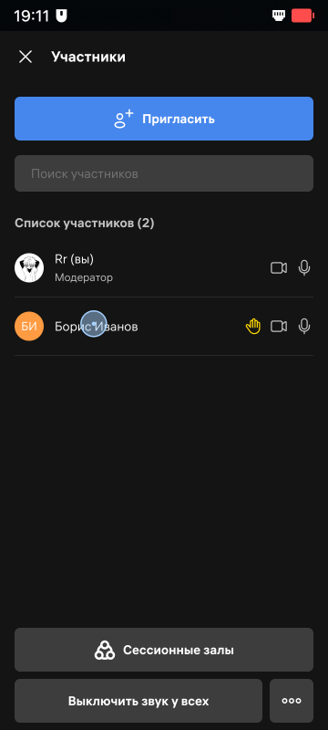

**EN** | [RU](README.ru.md)

# Jitsi Meet for Aurora OS

MIREA — Russian Technological University (MIREA)

A Jitsi Meet video conferencing client for smartphones running Aurora OS 5. The interface follows the Jitsi mobile client, and its strings come from Jitsi's language files.

**Purpose.** A final qualifying work: a working Aurora OS client that is compatible with Jitsi Meet servers and close to the Android and iOS clients in behaviour.

**Features.** Joining rooms by name or link, meeting history, camera and microphone, chat, polls, reactions, moderation, live streaming to YouTube, sign-in to protected servers, work in the background.

**Non-system libraries:**

- [lib-jitsi-meet](https://github.com/jitsi/lib-jitsi-meet), Apache 2.0, loaded from the Jitsi server during a meeting;
- room name functions from [jitsi-js-utils](https://github.com/jitsi/js-utils), Apache 2.0;
- language files, icons and sounds of [Jitsi Meet](https://github.com/jitsi/jitsi-meet), Apache 2.0;
- [flag-icons](https://github.com/lipis/flag-icons), MIT;
- emoji graphics, CC BY 4.0.

## Contents

- [Detailed description](#detailed-description)
- [Compatibility](#compatibility)
- [Build](#build)
- [Installation and launch](#installation-and-launch)
- [Screenshots](#screenshots)
- [Usage](#usage)
- [Known issues and limitations](#known-issues-and-limitations)
- [Terms of use and contributing](#terms-of-use-and-contributing)

## Detailed description

- **Rooms.** A room name or link, meeting history by date, a room menu (removal, dial-in numbers), a warning about an insecure room name.
- **Profile.** Name and email, a Gravatar avatar that other participants see.
- **Meeting.** Camera, microphone, camera switching, tile view, chat and private messages, polls, reactions, GIFs (GIPHY), raised hand, whiteboard, shared YouTube video, speaker statistics, audio-only mode, recording and subtitles on servers that have them. Audio level rings appear around the avatar of the speaker on the main view. A connection indicator appears on the tile of a participant with a poor connection, red or yellow, and disappears when the connection is stable again.
- **Moderation.** Actions on participants, mute everyone with audio moderation, lobby, room password, breakout rooms, visitors, chat restrictions, follow me.
- **Live streaming** to YouTube by stream key.
- **Protected servers.** A login and password (Prosody) or an organizer token (JWT). They are kept in a file encrypted with a key from Aurora Keystore, and the next meetings open without asking again.
- **Background work.** A meeting continues with the screen locked or the application minimized. A notification offers microphone and leave buttons, and the cover shows the meeting time and the same actions.
- **Settings.** Server, language (Russian, English), sounds, notifications, initial camera and microphone state, moderator section, build information.

The screens outside a meeting are written in QML (Silica). The meeting screen is the application's own client on lib-jitsi-meet in a WebView. C++ code keeps rooms and settings in SQLite, stores logins encrypted with a key from Aurora Keystore, and publishes the meeting notification. See [doc/architecture.md](doc/architecture.md) (in Russian).

## Compatibility

Aurora OS 5.2 and Aurora OS 5.1.

- **Aurora OS 5.2** uses the Chromium based Aurora WebView. Tested on the emulator 5.2.1.200 x86_64.
- **Aurora OS 5.1** has only the Gecko based Sailfish WebView (Gecko 78). The same code builds a separate package for it (`webview/gecko`). Tested on the emulator 5.1.1.60 x86_64 and on the KVADRA_T tablet (5.1.1.60 aarch64): joining a meeting, a meeting of two, the camera, the microphone, screen sharing (as a second video track beside the camera), reactions, the raised hand, the whiteboard. lib-jitsi-meet officially supports Firefox 91 and later, so on Gecko 78 the application works around what the engine lacks:
  - the camera is taken by the application (Qt camera) and given to the meeting page frame by frame, since the Gecko camera gives no frames on some devices; the picture size follows what the device manages to encode (up to the server's resolution) and stays upright when the device turns;
  - the microphone level is raised while someone speaks when the device gives a quiet signal;
  - the whiteboard code of the server, built for newer browsers, is rewritten for Gecko 78 when it loads (`qml/call/legacy`, with the [acorn](https://github.com/acornjs/acorn) parser);
  - endpoint messages (reactions, lower hand) go over XMPP while the bridge data channel is not open;
  - meeting sounds use the server's Opus files;
  - the WebView has no H264 decoder and VP9 is switched off in it: VP9 is switched on and only VP8 and VP9 are announced, so the screen shared from the Jitsi mobile app is shown (at the resolution the bridge sends, 480x270 in the tests).

  Known limitation: on meet.jit.si the Gecko 78 connection to the video bridge does not complete (no audio or video); other servers tested (meet.systemli.org, the OMP server) work.

The packages for devices build and pass the validator, but they have not been run on a device yet.

## Build

General guide: [Aurora SDK](https://developer.auroraos.ru/doc/sdk). No additional modules or parameters are needed.

In Aurora IDE, open `ru.mirea.JitsiClient.pro`, choose a target and build. From the command line:

```bash
sfdk config target=AuroraOS-5.2.1.200-aarch64
sfdk build
```

The package appears in `RPMS/`. Use the target `AuroraOS-5.2.1.200-x86_64` for the emulator. For Aurora OS 5.1 build with Aurora SDK 5.1 and its targets (`AuroraOS-5.1.1.60-base-aarch64` and others): the spec file reads the OS version of the target and builds the Gecko variant. To check the package with the validator:

```bash
sfdk check RPMS/<package>.rpm
```

## Installation and launch

Ready packages of the latest version are in [packages](packages):

| Package | For |
|---|---|
| `ru.mirea.JitsiClient-0.1-135.aarch64.rpm` | 64-bit devices |
| `ru.mirea.JitsiClient-0.1-135.armv7hl.rpm` | 32-bit devices |
| `ru.mirea.JitsiClient-0.1-135.x86_64.rpm` | Aurora OS emulator |

These packages are for Aurora OS 5.2. Packages for Aurora OS 5.1 are in [packages/aurora-5.1](packages/aurora-5.1):

| Package | For |
|---|---|
| `ru.mirea.JitsiClient-0.1-154.aarch64.rpm` | 64-bit devices with Aurora OS 5.1 |
| `ru.mirea.JitsiClient-0.1-154.armv7hl.rpm` | 32-bit devices with Aurora OS 5.1 |
| `ru.mirea.JitsiClient-0.1-154.x86_64.rpm` | Aurora OS 5.1 emulator |

They are signed with the SDK development key, so they install on a device or emulator in developer mode.

To install a package of your own build:

1. Sign the package. For development, use the SDK key:

   ```bash
   sfdk engine exec rpmsign-external sign --key <key.pem> --cert <cert.pem> RPMS/<package>.rpm
   ```

2. Install it on the device or emulator and grant the permissions on first launch.

A Jitsi Meet server is required. The default is `https://meet.jit.si`, and the address can be changed in the settings.

On the emulator, the camera has to be started in Aurora IDE: Tools → Aurora OS → Emulation management → Camera.

## Screenshots

<table>
  <tr>
    <td></td>
    <td></td>
    <td></td>
  </tr>
  <tr>
    <td></td>
    <td></td>
    <td></td>
  </tr>
</table>

## Usage

1. **Join a meeting.** Enter a room name or link on the main screen, or choose a room from the history, then press "Join meeting".
2. **Sign in.** If the server asks for it, enter a login and password; they are saved for the next meetings.
3. **Control the meeting.** Use the bottom toolbar for the microphone, camera, chat, menu and leaving. The participant list is in the top right corner.
4. **Moderate.** Press and hold a participant's tile, or open the participant in the list.
5. **Change the server.** Open the "Settings" tab.

A full description is in [doc/project_description.md](doc/project_description.md) (in Russian).

## Known issues and limitations

- **No device testing yet.** The application has been tested on the emulator only.
- **Screen sharing.** Implemented through StreamCamera but not confirmed: on the emulator, capture starts and no frames arrive.
- **Aurora Keystore.** It is unavailable on a regular emulator, so there logins are kept only until the application closes. Work with the store has been tested on the emulator with SoftHSM, bypassing the system CUSE layer. The regular path and TEE have to be tested on a device.
- **Rejoining.** Without restarting the application, `gum.not_found` for audio sometimes appears. The cause is not known.
- **Camera preview on the emulator.** The Qt Multimedia render thread sometimes crashes on the screen before joining (`QVideoFrame::unmap`).
- **Own connection indicator on the emulator.** With the camera on, it stays yellow without any packet loss, because the quality estimate stays low there.
- **Ask to unmute.** Without audio moderation, it works only between clients of this application.
- **Trust in the server.** The meeting page runs code from the Jitsi server. Screen sharing is confirmed in an application dialog, but the camera and microphone are allowed automatically, so join only servers you trust.
- **Stream key.** It is kept separately for each server. A key saved by an earlier version is removed and has to be entered again.
- **Files in chat.** Not implemented. The `fileSharing` feature exists only in the Jitsi web client and needs separate server setup.
- **Launch.** On the emulator the application sometimes opens minimized, on its cover (1 time out of 3 in the check). The cause is not known.
- **Recording and subtitles.** The buttons appear when the server enables them. They follow the Jitsi sources but have not been tested with a real Jibri or transcriber: the request reaches the test server and is refused, because it has neither service. Choosing a language, translated subtitles and recording sounds are not implemented.
- **Calendar.** The tab is always empty. Reading Aurora OS events needs the `Calendar` permission, and a package with it fails the validator and does not install.

Test details are in [doc/testing.md](doc/testing.md) (in Russian).

## Terms of use and contributing

- [LICENSE.md](LICENSE.md)
- [AUTHORS.md](AUTHORS.md)
- [CONTRIBUTING.md](CONTRIBUTING.md)
