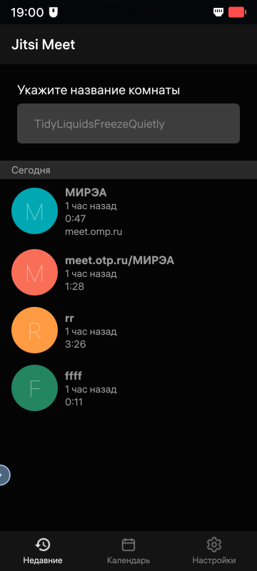
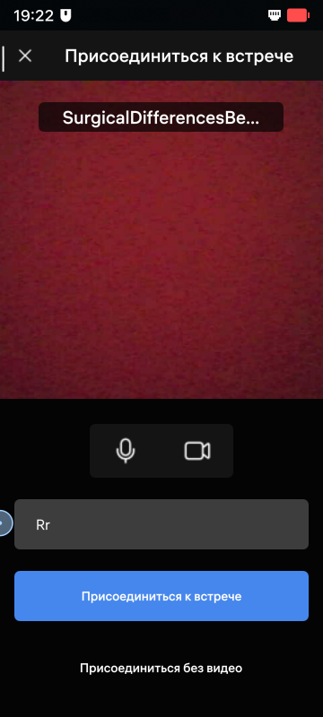
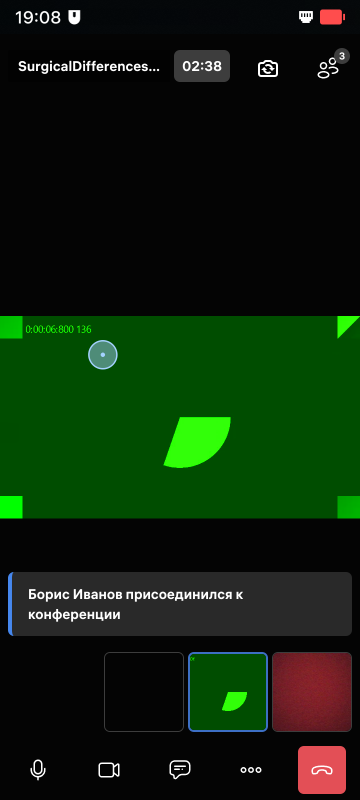
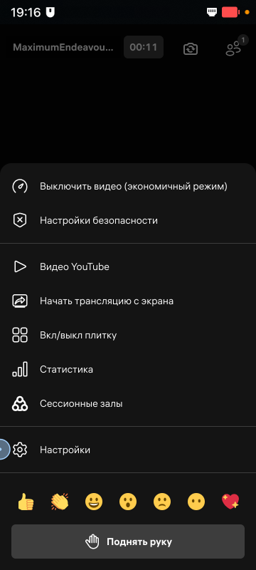
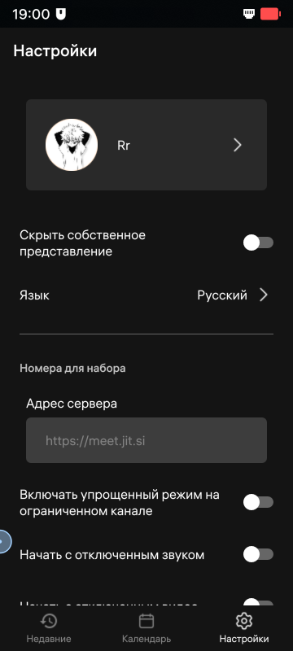

**EN** | [RU](README.ru.md)

# Jitsi Meet for Aurora OS

MIREA — Russian Technological University (MIREA)

A Jitsi Meet video conferencing client for smartphones running Aurora OS 5. The interface follows the Jitsi mobile client, and its strings come from Jitsi's language files.

**Purpose.** A final qualifying work: a working Aurora OS client that is compatible with Jitsi Meet servers and close to the Android and iOS clients in behaviour.

**Features.** Joining rooms by name or link, meeting history, camera and microphone, chat, polls, reactions, moderation, live streaming to YouTube, sign-in to protected servers, work in the background.

**Non-system libraries:**

- [lib-jitsi-meet](https://github.com/jitsi/lib-jitsi-meet), Apache 2.0, loaded from the Jitsi server during a meeting;
- room name functions from [jitsi-js-utils](https://github.com/jitsi/js-utils), Apache 2.0;
- language files, icons and sounds of [Jitsi Meet](https://github.com/jitsi/jitsi-meet), Apache 2.0;
- [flag-icons](https://github.com/lipis/flag-icons), MIT;
- emoji graphics, CC BY 4.0.

## Contents

- [Detailed description](#detailed-description)
- [Compatibility](#compatibility)
- [Build](#build)
- [Installation and launch](#installation-and-launch)
- [Screenshots](#screenshots)
- [Usage](#usage)
- [Known issues and limitations](#known-issues-and-limitations)
- [Terms of use and contributing](#terms-of-use-and-contributing)

## Detailed description

- **Rooms.** A room name or link, meeting history by date, a room menu (removal, dial-in numbers), a warning about an insecure room name.
- **Profile.** Name and email, a Gravatar avatar that other participants see.
- **Meeting.** Camera, microphone, camera switching, tile view, chat and private messages, polls, reactions, GIFs (GIPHY), raised hand, whiteboard, shared YouTube video, speaker statistics, audio-only mode. A connection indicator appears on the tile of a participant with a poor connection, red or yellow, and disappears when the connection is stable again.
- **Moderation.** Actions on participants, mute everyone with audio moderation, lobby, room password, breakout rooms, visitors, chat restrictions, follow me.
- **Live streaming** to YouTube by stream key.
- **Protected servers.** A login and password (Prosody) or an organizer token (JWT). They are kept in an encrypted container, and the next meetings open without asking again.
- **Background work.** A meeting continues with the screen locked or the application minimized. A notification offers microphone and leave buttons, and the cover shows the meeting time and the same actions.
- **Settings.** Server, language (Russian, English), sounds, notifications, initial camera and microphone state, moderator section, build information.

The screens outside a meeting are written in QML (Silica). The meeting screen is the application's own client on lib-jitsi-meet in a WebView. C++ code keeps rooms and settings in SQLite, stores logins through `sstore` and Aurora Keystore, and publishes the meeting notification. See [doc/architecture.md](doc/architecture.md) (in Russian).

## Compatibility

Aurora OS 5.2. Tested on the emulator 5.2.1.200 x86_64. The aarch64 package builds and passes the validator, but it has not been run on a device yet.

## Build

General guide: [Aurora SDK](https://developer.auroraos.ru/doc/sdk). No additional modules or parameters are needed.

In Aurora IDE, open `ru.vkr.JitsiAuroraPrototype.pro`, choose a target and build. From the command line:

```bash
sfdk config target=AuroraOS-5.2.1.200-aarch64
sfdk build
```

The package appears in `RPMS/`. Use the target `AuroraOS-5.2.1.200-x86_64` for the emulator. To check the package with the validator:

```bash
sfdk check RPMS/<package>.rpm
```

## Installation and launch

1. Sign the package. For development, use the SDK key:

   ```bash
   sfdk engine exec rpmsign-external sign --key <key.pem> --cert <cert.pem> RPMS/<package>.rpm
   ```

2. Install it on the device or emulator and grant the permissions on first launch.

A Jitsi Meet server is required. The default is `https://meet.jit.si`, and the address can be changed in the settings.

On the emulator, `sstore` has to be installed for saved logins (`pkcon install sstore`), and the camera has to be started in Aurora IDE: Tools → Aurora OS → Emulation management → Camera.

## Screenshots

<table>
  <tr>
    <td></td>
    <td></td>
    <td></td>
  </tr>
  <tr>
    <td></td>
    <td></td>
    <td></td>
  </tr>
</table>

## Usage

1. **Join a meeting.** Enter a room name or link on the main screen, or choose a room from the history, then press "Join meeting".
2. **Sign in.** If the server asks for it, enter a login and password; they are saved for the next meetings.
3. **Control the meeting.** Use the bottom toolbar for the microphone, camera, chat, menu and leaving. The participant list is in the top right corner.
4. **Moderate.** Press and hold a participant's tile, or open the participant in the list.
5. **Change the server.** Open the "Settings" tab.

A full description is in [doc/project_description.md](doc/project_description.md) (in Russian).

## Known issues and limitations

- **No device testing yet.** The application has been tested on the emulator only.
- **Screen sharing.** Implemented through StreamCamera but not confirmed: on the emulator, capture starts and no frames arrive.
- **Aurora Keystore.** It is unavailable on the emulator, where a fallback key file is used, so computing the container password in the store has not been tested.
- **Rejoining.** Without restarting the application, `gum.not_found` for audio sometimes appears. The cause is not known.
- **Camera preview on the emulator.** The Qt Multimedia render thread sometimes crashes on the screen before joining (`QVideoFrame::unmap`).
- **Own connection indicator on the emulator.** With the camera on, it stays yellow without any packet loss, because the quality estimate stays low there.
- **Ask to unmute.** Without audio moderation, it works only between clients of this application.
- **Trust in the server.** The meeting page runs code from the Jitsi server. Screen sharing is confirmed in an application dialog, but the camera and microphone are allowed automatically, so join only servers you trust.
- **Stream key.** It is kept separately for each server. A key saved by an earlier version is removed and has to be entered again.
- **Calendar.** The tab exists, but events from the Aurora OS calendar are not read.

Test details are in [doc/testing.md](doc/testing.md) (in Russian).

## Terms of use and contributing

- [LICENSE.md](LICENSE.md)
- [AUTHORS.md](AUTHORS.md)
- [CONTRIBUTING.md](CONTRIBUTING.md)
