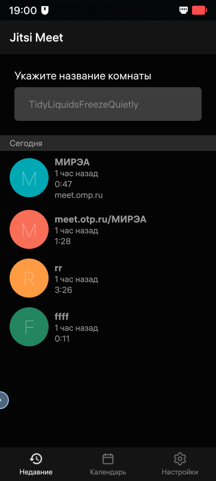
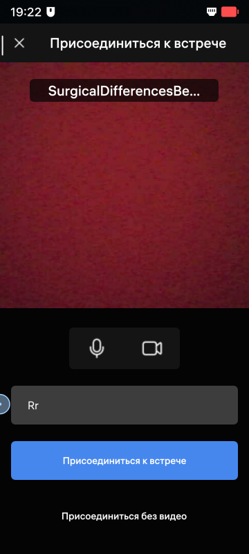
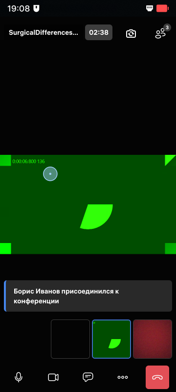
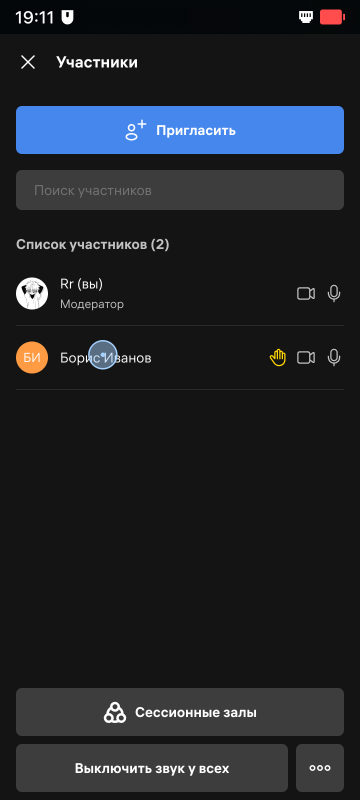
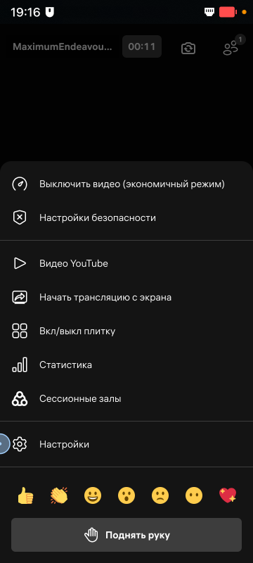
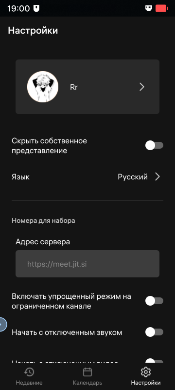

[EN](README.md) | **RU**

# Jitsi Meet для ОС Аврора

МИРЭА — Российский технологический университет (MIREA)

Клиент видеоконференций Jitsi Meet для смартфонов на ОС Аврора 5. Интерфейс повторяет мобильный клиент Jitsi, надписи берутся из языковых файлов Jitsi.

**Цель.** Выпускная квалификационная работа: рабочий клиент для ОС Аврора, совместимый с серверами Jitsi Meet и близкий по поведению к клиентам для Android и iOS.

**Функции.** Вход в комнату по названию или ссылке, история встреч, камера и микрофон, чат, опросы, реакции, модерация, трансляция на YouTube, вход на защищённые серверы, работа в фоне.

**Несистемные библиотеки:**

- [lib-jitsi-meet](https://github.com/jitsi/lib-jitsi-meet), Apache 2.0, загружается с сервера Jitsi во время встречи;
- функции названий комнат из [jitsi-js-utils](https://github.com/jitsi/js-utils), Apache 2.0;
- языковые файлы, значки и звуки [Jitsi Meet](https://github.com/jitsi/jitsi-meet), Apache 2.0;
- [flag-icons](https://github.com/lipis/flag-icons), MIT;
- графика эмодзи, CC BY 4.0.

## Содержание

- [Подробное описание](#подробное-описание)
- [Совместимость](#совместимость)
- [Сборка](#сборка)
- [Установка и запуск](#установка-и-запуск)
- [Скриншоты](#скриншоты)
- [Варианты использования](#варианты-использования)
- [Известные ошибки и ограничения](#известные-ошибки-и-ограничения)
- [Правила использования и участие в разработке](#правила-использования-и-участие-в-разработке)

## Подробное описание

- **Комнаты.** Ввод названия или ссылки, история встреч по датам, меню комнаты (удаление, телефонный вход), предупреждение о небезопасном названии.
- **Профиль.** Имя и почта, аватар из Gravatar, который видят другие участники.
- **Встреча.** Камера, микрофон, переключение камеры, плиточный вид, чат и личные сообщения, опросы, реакции, GIF (GIPHY), поднятая рука, доска, совместный просмотр видео YouTube, статистика выступающих, режим «только звук». На плитке участника с плохой связью появляется красный или жёлтый значок, при стабильной связи он исчезает.
- **Модерация.** Действия с участниками, «выключить звук у всех» с модерацией звука, лобби, пароль комнаты, сессионные залы, посетители, ограничения чата, «следовать за мной».
- **Трансляция** на YouTube по ключу.
- **Вход на защищённые серверы.** Логин и пароль (Prosody) или токен организатора (JWT). Данные хранятся в криптоконтейнере, следующие встречи открываются без ввода.
- **Работа в фоне.** Встреча не прерывается при блокировке экрана и в свёрнутом приложении. В шторке есть уведомление с кнопками «Микрофон» и «Выход», на обложке показаны таймер встречи и те же действия.
- **Настройки.** Сервер, язык (русский, английский), звуки, уведомления, начальное состояние камеры и микрофона, раздел модератора, сведения о сборке.

Экраны вне встречи написаны на QML (Silica). Экран встречи представляет собой собственный клиент на lib-jitsi-meet в WebView. Код на C++ хранит комнаты и настройки в SQLite, сохраняет логины через `sstore` и Aurora Keystore и публикует уведомление встречи. Подробнее в [doc/architecture.md](doc/architecture.md).

## Совместимость

ОС Аврора 5.2. Проверено на эмуляторе 5.2.1.200 x86_64. Пакет aarch64 собирается и проходит валидатор, на устройстве пока не запускался.

## Сборка

Общее руководство: [Aurora SDK](https://developer.auroraos.ru/doc/sdk). Дополнительные модули и параметры не нужны.

В Aurora IDE откройте `ru.vkr.JitsiAuroraPrototype.pro`, выберите цель и соберите проект. Из командной строки:

```bash
sfdk config target=AuroraOS-5.2.1.200-aarch64
sfdk build
```

Пакет появится в `RPMS/`. Для эмулятора используйте цель `AuroraOS-5.2.1.200-x86_64`. Проверка пакета валидатором:

```bash
sfdk check RPMS/<пакет>.rpm
```

## Установка и запуск

1. Подпишите пакет. Для разработки подойдёт ключ SDK:

   ```bash
   sfdk engine exec rpmsign-external sign --key <ключ.pem> --cert <сертификат.pem> RPMS/<пакет>.rpm
   ```

2. Установите его на устройство или эмулятор и при первом запуске дайте разрешения.

Нужен сервер Jitsi Meet. По умолчанию это `https://meet.jit.si`, адрес меняется в настройках.

На эмуляторе для сохранения логинов нужно установить `sstore` (`pkcon install sstore`), а камеру запустить в Aurora IDE: Инструменты → ОС Аврора → Управление эмуляцией → Камера.

## Скриншоты

<table>
  <tr>
    <td></td>
    <td></td>
    <td></td>
  </tr>
  <tr>
    <td></td>
    <td></td>
    <td></td>
  </tr>
</table>

## Варианты использования

1. **Войти во встречу.** На главном экране введите название комнаты или ссылку либо выберите комнату из истории, затем нажмите «Присоединиться к встрече».
2. **Войти на сервер.** Если сервер просит вход, введите логин и пароль, они сохранятся для следующих встреч.
3. **Управлять встречей.** На нижней панели находятся микрофон, камера, чат, меню и выход. Список участников открывается в правом верхнем углу.
4. **Модерировать.** Нажмите и удерживайте плитку участника или откройте его в списке.
5. **Сменить сервер.** Откройте вкладку «Настройки».

Полное описание находится в [doc/project_description.md](doc/project_description.md).

## Известные ошибки и ограничения

- **Нет проверки на устройстве.** Приложение проверено только на эмуляторе.
- **Показ экрана.** Реализован через StreamCamera, но не подтверждён: на эмуляторе захват запускается, а кадры не приходят.
- **Aurora Keystore.** На эмуляторе недоступен, там используется запасной файл ключа, поэтому вычисление пароля контейнера в хранилище не проверено.
- **Повторный вход.** Без перезапуска приложения иногда появляется `gum.not_found` для звука. Причина не установлена.
- **Предпросмотр камеры на эмуляторе.** На экране перед входом иногда падает поток отрисовки Qt Multimedia (`QVideoFrame::unmap`).
- **Значок связи своей плитки на эмуляторе.** С включённой камерой он остаётся жёлтым и без потерь пакетов, потому что оценка качества там низкая.
- **Запрос включить микрофон.** Без модерации звука работает только между клиентами этого приложения.
- **Доверие к серверу.** Страница встречи выполняет код сервера Jitsi. Показ экрана подтверждается в окне приложения, а камера и микрофон разрешаются автоматически, поэтому заходите только на серверы, которым доверяете.
- **Ключ трансляции.** Хранится отдельно для каждого сервера. Ключ, сохранённый прежней версией, удаляется, и его нужно ввести заново.
- **Календарь.** Вкладка есть, события из календаря Авроры не читаются.

Подробности проверки находятся в [doc/testing.md](doc/testing.md).

## Правила использования и участие в разработке

- [LICENSE.md](LICENSE.md)
- [AUTHORS.md](AUTHORS.md)
- [CONTRIBUTING.md](CONTRIBUTING.md)
